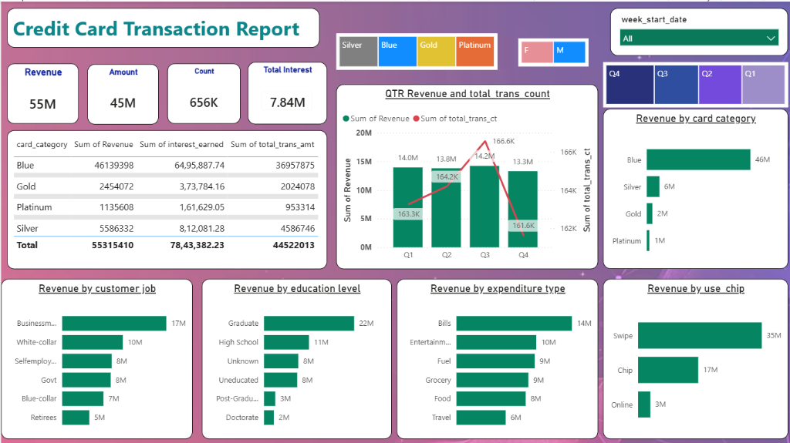
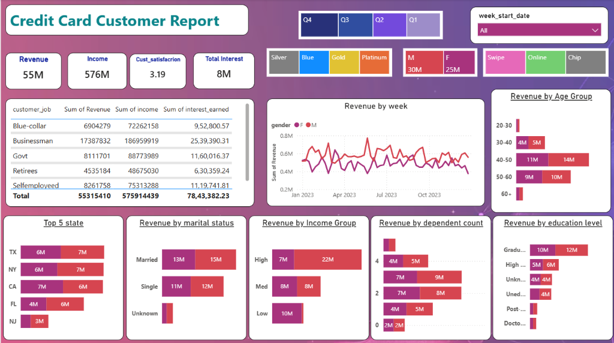

# 💳 Credit Card Financial & Customer Analytics (Power BI & SQL)

[](https://payoli-kumari.github.io/Credit_Card_Analytics/)
[](https://powerbi.microsoft.com/)
[](https://learn.microsoft.com/en-us/dax/)
[](https://www.postgresql.org/)

---

## 📌 Live Interactive Portfolio Webpage
👉 **View Live Web Showcase:** [https://payoli-kumari.github.io/Credit_Card_Analytics/](https://payoli-kumari.github.io/Credit_Card_Analytics/)

---

## 📊 Executive Project Overview

This project provides an end-to-end data analysis solution for credit card transaction performance and customer demographics. Built using **Power BI**, **DAX**, **SQL**, and **Power Query**, it transforms raw transaction and customer feeds into real-time interactive executive dashboards.

### 🌟 Key Performance Indicators (KPIs)
* **Total Revenue Generated:** `$55.3M`
* **Total Interest Earned:** `$7.84M`
* **Total Transaction Volume:** `656,000+`
* **Total Customer Annual Income:** `$576M`
* **Average Customer Satisfaction Score:** `3.19 / 5.0`

---

## 🖼️ Dashboard Previews

### 1. Credit Card Transaction Report
Monitors transaction streams, revenue breakdown by card category, expenditure types, and payment modes (Swipe vs Chip vs Online).



### 2. Credit Card Customer Report
Segmenting customers by age bracket, education level, job profile, marital status, state-level distribution, and income group.



---

## 📁 Repository Directory Structure

```text
Credit_Card_Analytics/
├── index.html                    # Main portfolio website (GitHub Pages Entry Point)
├── styles.css                    # Styling & theme variables
├── script.js                     # Tab switching, lightbox & interactive controls
├── README.md                     # Project documentation & GitHub guide
├── assets/
│   └── images/
│       ├── transaction_report.png # High-res Transaction Dashboard screenshot
│       └── customer_report.png    # High-res Customer Dashboard screenshot
├── datasets/
│   ├── credit_card.csv           # Baseline transaction dataset
│   ├── customer.csv              # Baseline customer profile dataset
│   ├── cc_add.csv                # Weekly incremental transaction feed
│   └── cust_add.csv              # Weekly incremental customer feed
└── sql/
    └── credit_card_database.sql  # Database creation schema & bulk COPY queries
```

---

## 🔍 Core Business Insights Discovered

1. **Blue Card Dominance:** Blue Cardholders drive **83.4% ($46.1M)** of overall revenue and **$6.5M** of total interest earned.
2. **Channel Preference:** Physical **Swipe transactions** represent **$35M** (63% of total), followed by **Chip** ($17M). Online payments ($3M) present a strategic growth opportunity.
3. **High-Value Customer Profiles:** **Graduates** ($22M revenue) and **Businessmen** ($17M revenue) lead customer spending. The **40–50 age group** is the highest revenue-generating demographic segment ($25M).
4. **Top 3 Geographical Markets:** **Texas (TX)**, **New York (NY)**, and **California (CA)** contribute **$39M** combined (over 70% of customer revenue).

---

## 🛠️ Technical Details: DAX & SQL

### Key DAX Measures

#### 1. Age Group Classification
```dax
AgeGroup = 
SWITCH(
    TRUE(),
    'customer'[Customer_Age] < 30, "20-30",
    'customer'[Customer_Age] >= 30 && 'customer'[Customer_Age] < 40, "30-40",
    'customer'[Customer_Age] >= 40 && 'customer'[Customer_Age] < 50, "40-50",
    'customer'[Customer_Age] >= 50 && 'customer'[Customer_Age] < 60, "50-60",
    'customer'[Customer_Age] >= 60, "60+",
    "Unknown"
)
```

#### 2. Total Revenue Formula
```dax
Total_Revenue = 
SUM('credit_card'[Total_Trans_Amt]) + SUM('credit_card'[Annual_Fees]) + SUM('credit_card'[Interest_Earned])
```

#### 3. Week-on-Week (WoW) Revenue Growth
```dax
WoW_Revenue_Growth = 
VAR CurrentWeek = [Current_Week_Revenue]
VAR PreviousWeek = [Previous_Week_Revenue]
RETURN 
DIVIDE(CurrentWeek - PreviousWeek, PreviousWeek, 0)
```

---

## 🌐 How to Enable GitHub Pages (Web Hosting)

1. Open your repository settings: [Repository Settings Page](https://github.com/payoli-kumari/Credit_Card_Analytics/settings/pages).
2. Under **Build and deployment**:
   - **Source:** Select `Deploy from a branch`.
   - **Branch:** Choose `main` branch and `/ (root)` folder.
3. Click **Save**.
4. GitHub Pages will build and host your portfolio website at:
   `https://payoli-kumari.github.io/Credit_Card_Analytics/`

---

### 👤 Author
* **Payoli Kumari** - *Data & BI Analyst*
* **Tools:** Power BI, SQL, DAX, Excel, HTML/CSS/JS
